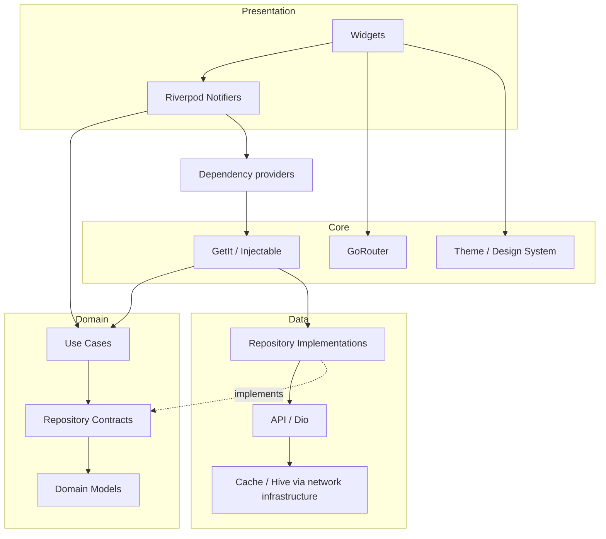

[](https://github.com/tsnAnh/flutter-agentic-starter/actions/workflows/dart.yml)
[](https://opensource.org/licenses/MIT)
[](https://flutter.dev)
[](https://dart.dev)
[](https://pub.dev/packages/flutter_lints)

# SeeMate AI

SeeMate AI is an Android assistive application project for blind and low-vision
Vietnamese-speaking users. Its MVP aims to recognize and find everyday objects,
announce their left/center/right position in the camera view, and read printed
Vietnamese text aloud. Core recognition is intended to run on-device; this is
an assistance tool, not a safe-navigation or obstacle-avoidance system.

The repository originated from **Flutter Agentic Starter** by tsnAnh and retains
its Flutter, Riverpod 2, Clean Architecture, setup tooling, and shared
infrastructure. Product requirements are recorded in the
[PDR](docs/project-overview-pdr.md) and [PRD](tasks/prd-seemate-ai.md).

## Current status

As of 2026-11-08, the project is in the foundation stage. Running the app opens
the Home reference feature, which loads cities from an HTTP API and shows
loading, data, localized error, and retry states.

| Area | Repository state |
| --- | --- |
| Working reference feature | Home city loading with Riverpod providers/notifier and GoRouter |
| Inherited infrastructure | DI, networking, cache, HTTP offline-write queue, permission wrappers, shared widgets, and Widgetbook |
| Localization | English resources; Vietnamese UI and TalkBack task validation are pending |
| MVP features | Camera, object recognition/search, relative-position guidance, OCR, STT/TTS, and accessibility preferences are not implemented |
| Product validation | Offline recognition, model quality, speech resources, and target-user acceptance remain unverified |

Starter Firebase/analytics initialization is still present. Disabling the
telemetry services specified by the PRD is planned work, not an existing privacy
or offline guarantee. See the [codebase summary](docs/codebase-summary.md),
[module guides](docs/module-guides.md), and [roadmap](docs/development-roadmap.md).

## Stack

- Riverpod 2 for reactive presentation state
- GetIt + Injectable for composition
- GoRouter for navigation
- Dio + fpdart for typed network results
- Hive for local cache and offline writes
- Freezed + json_serializable for immutable wire/domain models
- Flutter localization and Material 3
- Inherited Firebase and PostHog integrations, pending MVP policy changes

Camera, TensorFlow Lite/LiteRT, ML Kit OCR, Vietnamese STT/TTS, and local
accessibility preferences are target integrations tracked in
[PRD section 9.6](tasks/prd-seemate-ai.md#96-open-decisions-and-validation-gaps).

## Architecture



Features use `data/domain/presentation` boundaries:

```text
Screen -> Riverpod notifier -> Use case -> Repository -> Data source
   ^          |
   +-- AsyncValue<T>
```

Riverpod notifiers own feature state and expose it through providers. Screens
rebuild with `ConsumerWidget` or focused `Consumer` boundaries. GetIt supplies
use cases and infrastructure through focused dependency providers. The router
creates `const HomeScreen()`; it does not inject a notifier. Shared services
expose plain getters and selected event streams; reading a getter alone does
not create a reactive subscription.

See [System architecture](docs/system-architecture.md) and
[Code standards](docs/code-standards.md).

## Inherited infrastructure

These modules are available in the starter foundation; their presence does not
mean SeeMate AI's MVP flows or acceptance checks are complete.

| Module | Description | Key packages |
| --- | --- | --- |
| **State** | Home presentation state | Riverpod 2 |
| **Network** | HTTP client, authentication, caching, retry, and connectivity interceptors | Dio |
| **Auth** | Session/token helpers; no login feature; storage is memory-only | Dart SDK |
| **Cache** | Memory and persistent cache policies | Hive, Hive Flutter |
| **Connectivity** | Network monitoring and offline HTTP-write replay; distinct from offline AI | Connectivity Plus, Hive |
| **DI** | Generated dependency injection | GetIt, Injectable |
| **Router** | Declarative routing and deep links | GoRouter, App Links |
| **Models** | Immutable wire and domain models | Freezed, json_serializable |
| **Widgets** | Responsive shared widgets and generated component catalog | ScreenUtil, Widgetbook |
| **Firebase** | Analytics, Crashlytics, Remote Config, Messaging, and App Check | Firebase |
| **Analytics** | Composite analytics providers | Firebase Analytics, PostHog |
| **Permissions** | Runtime permission wrappers; camera/microphone workflows pending | Permission Handler |
| **Forms** | Validated reusable form inputs | Formz |
| **Lifecycle** | App lifecycle and update checks | Flutter SDK |
| **Logger** | Debug and production logging | Logger |
| **Localization** | Generated English strings; Vietnamese pending | Flutter localization, intl |

## Quick Start

```sh
# From the repository root, with Flutter and Android tooling installed
flutter pub get

# Generate code
dart run build_runner build --delete-conflicting-outputs

# Run on a connected Android device or emulator
flutter run -t lib/main.dart
```

Available entry points:

- `lib/main.dart`
- `lib/main_staging.dart`
- `lib/main_production.dart`

See the [quick start](docs/quick-start-guide.md) for setup and focused tests.
For an Android evaluation APK with offline Vietnamese voice commands, follow
the [Zipformer Vietnamese 30M int8 setup](docs/evaluation/text_speech/n3-03-voice-commands.md).

## Widgetbook

Generate the catalog after adding or changing a use case:

```sh
dart run build_runner build --delete-conflicting-outputs
```

Run Widgetbook locally in Chrome:

```sh
flutter run -t lib/widgetbook/widgetbook.dart -d chrome
```

This is a component-catalog preview; the product MVP targets Android.

## Project Structure

```text
lib/
├── app.dart
├── main.dart
├── main_staging.dart
├── main_production.dart
├── core/
│   ├── analytics/
│   ├── assets/
│   ├── auth/
│   ├── cache/
│   ├── connectivity/
│   ├── design_system/
│   ├── di/
│   ├── extensions/
│   ├── firebase/
│   ├── lifecycle/
│   ├── logger/
│   ├── network/
│   ├── permissions/
│   ├── router/
│   ├── theme/
│   └── utils/
├── features/
│   └── home/
│       ├── data/
│       ├── domain/
│       └── presentation/
├── shared/
│   ├── data/
│   ├── forms/
│   ├── i18n/
│   ├── services/
│   └── widgets/
└── widgetbook/
    ├── use_cases/
    ├── widgetbook.dart
    └── widgetbook.directories.g.dart
```

## Create a feature

1. Add the domain model, repository contract, and use case.
2. Implement the data source and repository.
3. Bridge the use case from GetIt through a dependency provider.
4. Add a Riverpod notifier and `ConsumerWidget` screen; let GoRouter build the screen.
5. Add focused provider-state and widget tests.
6. Regenerate Injectable/Freezed/JSON code when source annotations change.

The Home feature is the reference implementation:
`lib/features/home/`.

## Identity and optional setup tooling

The product is SeeMate AI; the checked-in technical identity still comes from
the starter:

- Android app label: `SeeMate AI`
- Dart package: `flutter_agentic_starter`
- Organization: `Example`
- Android namespace/application ID: `dev.example.flutteragenticstarter`

The inherited setup wizard can rename a derivative project. It is optional and
is not required to run this checkout; changing the identity is a separate task.
If used, review its identity and instruction-file changes against this project's
Riverpod 2 conventions before keeping the generated edits.

```sh
dart run project_setup \
  --app-name "Your App" \
  --dart-package-name your_app \
  --app-id com.example.yourapp \
  --organization Example \
  --yes
```

## Verification

```sh
flutter analyze
flutter test
flutter build apk --release -t lib/main_staging.dart
```

The checked-in [CI workflow](.github/workflows/dart.yml) generates code, runs
`dart analyze`, and builds the staging APK. Its `flutter test` step is currently
commented out. It triggers on pushes to `development` or tags matching `v1.*`,
not pull requests. The Android release build still uses debug signing; these
commands do not establish MVP acceptance or production release readiness.
The [evaluation protocol](docs/evaluation-protocol.md) defines planned detection,
OCR, device, latency, and user checks; execution and pilot-target confirmation
remain pending.

## AI Agent Guide

### What Makes This Agent-Ready

Use `flutter-agentic-starter` only when implementing Flutter application code
under `lib/`, Flutter tests, or platform integration required by that code. It
does not apply to documentation, setup tooling, repository automation, or other
non-app maintenance.

- **Clean separation** — predictable `data/domain/presentation` boundaries
- **Riverpod conventions** — providers, notifiers, and `AsyncValue` state
- **Generated DI** — add Injectable annotations and regenerate
- **Preconfigured guidance** — `CLAUDE.md`, `AGENTS.md`, Cursor rules, and project skills

### Available Skills

- `flutter-agentic-starter` — Flutter/Riverpod/Clean Architecture rules
- `caveman` — concise technical communication
- `frontend-design` — polished user-facing Flutter UI

### Supported Tools

Works with Claude Code, Codex, OpenCode, Cursor, GitHub Copilot, Windsurf, and
other coding assistants that can read repository instructions.

### Example Prompts

```text
"Implement the next SeeMate AI roadmap milestone using the PRD acceptance criteria"
"Add tests for object-key mapping and left/center/right boundaries"
"Review a new control for Vietnamese TalkBack labels and Stop reading access"
```

## Configuration

### Flavors

| Flavor | Entry point | Use case |
| --- | --- | --- |
| Development | `lib/main.dart` | Local development |
| Staging | `lib/main_staging.dart` | QA and internal testing |
| Production | `lib/main_production.dart` | Release builds |

### Environment Setup

`lib/core/flavor_configurations.dart` selects the configuration name, API URL,
and timeouts; all three currently use the same sample API. Generated DI uses
the selected environment. The entry points are not separate Firebase projects
or completed native Android product flavors.

## Contributing

Contributions are welcome. See [CONTRIBUTING.md](CONTRIBUTING.md).

## License

[MIT](LICENSE) — tsnAnh

See the [documentation index](docs/README.md) for detailed guides.
