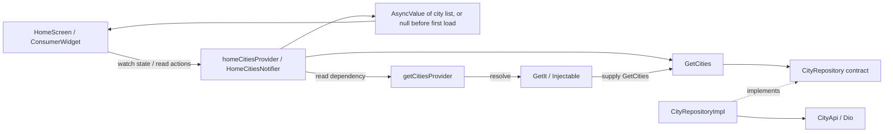
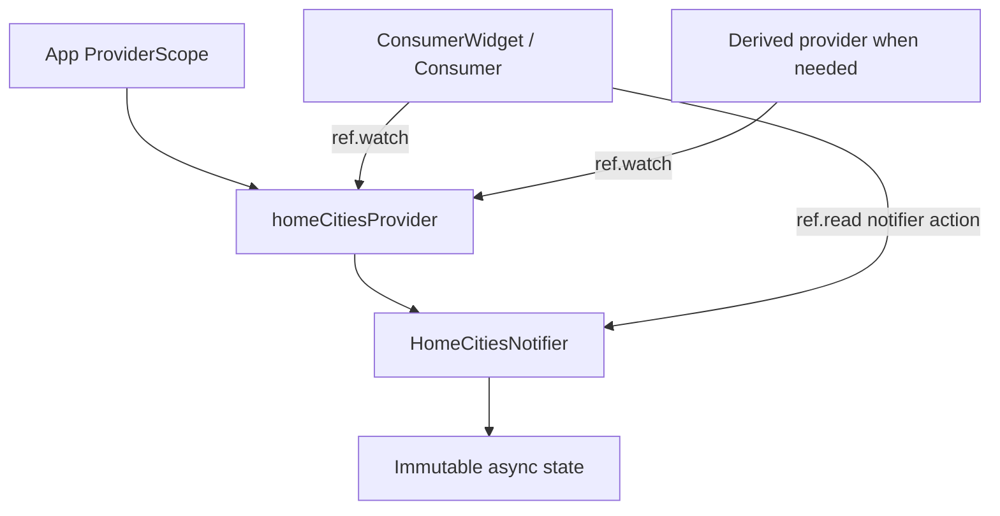
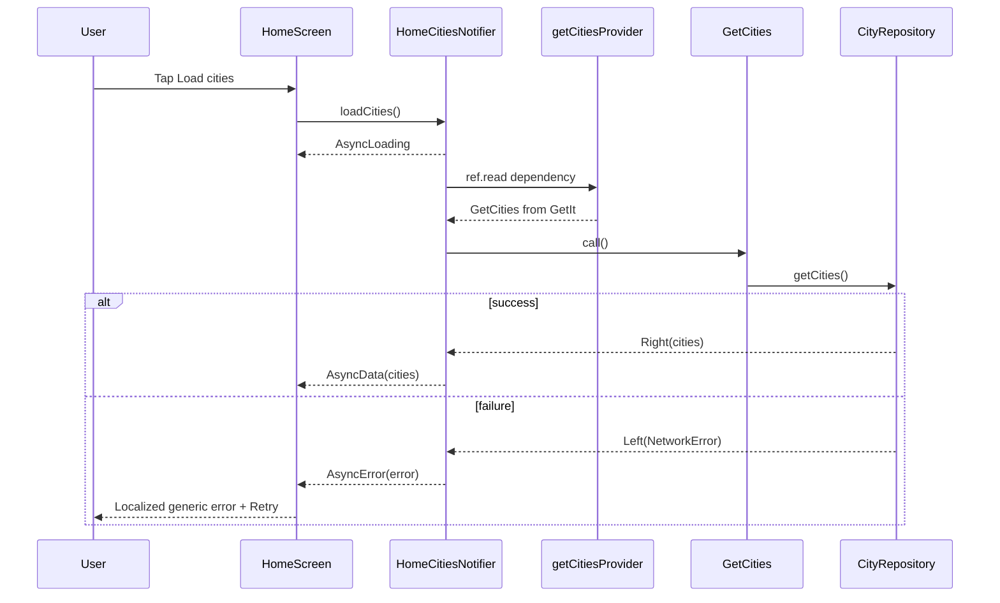
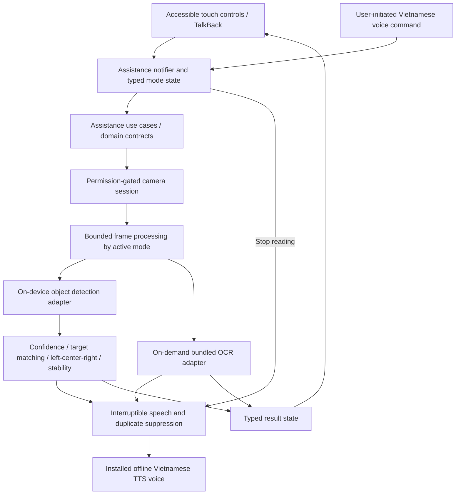

# System architecture

The current implementation is a Riverpod 2 starter foundation with a Home
city-loading example. The diagrams in the current-implementation sections
describe checked-in code. The camera/AI section is a target design, pending
implementation and validation against the [PRD](../tasks/prd-seemate-ai.md).

## Feature flow

Dependencies point toward domain code. The data layer implements domain
contracts; presentation never depends directly on Dio or Hive.

## State ownership

- Widget-only interaction state stays local.
- Feature state lives in Riverpod providers/notifiers. Home's provider is not
  auto-disposed; it remains in the app's provider container across route exits.
- New features must choose their lifetime explicitly. Auto-dispose requires
  matching Riverpod 2 provider/notifier types and owned-resource cleanup; a
  GoRouter route does not automatically create a provider scope.
- Existing shared infrastructure lives in GetIt lazy singletons. Derived
  reactive state belongs in providers using `ref.watch`.

## Async request sequence

## App composition

[`initializeFlutterApp`](../lib/app.dart) initializes Flutter bindings, Firebase, Hive, Injectable,
cache, connectivity, offline queue, error reporting, and analytics before
mounting `ProviderScope(child: App())`. `AppView` supplies
`AppRouter.routerConfig` to `MaterialApp.router` under that scope.

GoRouter owns navigation. The current `/` route builds `const HomeScreen()`.
`HomeScreen` watches `homeCitiesProvider`; its notifier reads
`getCitiesProvider`, which resolves `GetCities` from GetIt. Injectable composes
the use case, repository, and API dependencies. Riverpod owns the notifier;
the route does not inject a separate view-model instance.

Sources: [router](../lib/core/router/router.dart),
[Home providers](../lib/features/home/presentation/home_providers.dart), and
[DI composition](../lib/core/di/get_it.dart). Tests override the dependency
provider instead of requiring production GetIt setup.

The current bootstrap still initializes starter Firebase/analytics services.
The PRD's MVP policy to disable telemetry has not yet been implemented; it is
part of the target design, not an existing offline/privacy guarantee.

## Existing service state and cleanup

- `SessionManager.isActive`: plain session getter, initially false; `events`
  emits expiry/logout events, not every state change.
- `ConnectivityService.isOnline` and `isOffline`: plain getters for network
  interface availability; `onlineChanges` emits changes. This is not a guarantee
  of internet reachability.
- `OfflineQueueService.pendingCount`: Hive queue length.
- `PermissionViewModel.statuses`: permission state with resume rechecks.

Plain getters are not Riverpod subscriptions. Reading a GetIt service's mutable
getter inside a provider does not make it reactive. When a UI needs updates,
adapt an appropriate existing event stream through a provider, or design an
explicit state owner; do not promise events the service does not expose.

Any service that creates a connection stores its cleanup and releases it from
`dispose`. `PermissionViewModel` is consumer-owned, and its creator must call
`dispose` to remove its lifecycle observer. Provider-owned connections use
`ref.onDispose`; a provider borrowing a shared GetIt singleton must not dispose
that singleton on route exit. See [module guides](module-guides.md).

## Target design: camera and AI assistance (not implemented)

The following is the intended runtime flow for future assistance features;
arrows represent processing, not source-code import dependencies. It does not
describe existing classes, folders, registered services, or validated models.
Concrete boundaries and package versions must be confirmed during implementation
using the [PRD decision register](../tasks/prd-seemate-ai.md#96-open-decisions-and-validation-gaps).

- Keep domain contracts independent of camera, model runtime, and speech plugins;
  data/platform adapters implement them. GetIt composes dependencies and focused
  providers expose them to Riverpod-owned feature state.
- Grant permission before opening camera/microphone resources. Bound frame work
  so stale frames do not accumulate; OCR runs on request. Async processing does
  not by itself move CPU-heavy inference off the UI isolate; verify scheduling
  and benchmark responsiveness before selecting execution/delegate strategies.
- Use typed modes, results, and failures for resource readiness, denied
  permissions, unsupported objects, low-quality input, and speech availability.
  Surface localized feedback at the widget boundary; do not send frames through
  the starter HTTP cache or offline-write queue.
- Assign explicit owners for camera sessions, inference resources, STT sessions,
  and TTS playback. Stop/release resources on mode changes, backgrounding, and
  disposal as appropriate; reject stale async results after a session ends.
  Auto-dispose alone does not handle application backgrounding.
- Keep Stop reading reachable and speech interruptible. Coordinate TTS, STT,
  and TalkBack; touch alternatives remain available when offline STT is missing.
- Bundle detection/OCR resources, check installed offline Vietnamese voice
  resources, and avoid automatic cloud fallback. The target MVP disables the
  telemetry services listed in the PRD and does not log/store/transmit camera
  frames or log OCR/speech content.

This design requires physical-device camera/voice, TalkBack, offline, quality,
and performance checks before it can be described as implemented or validated.
